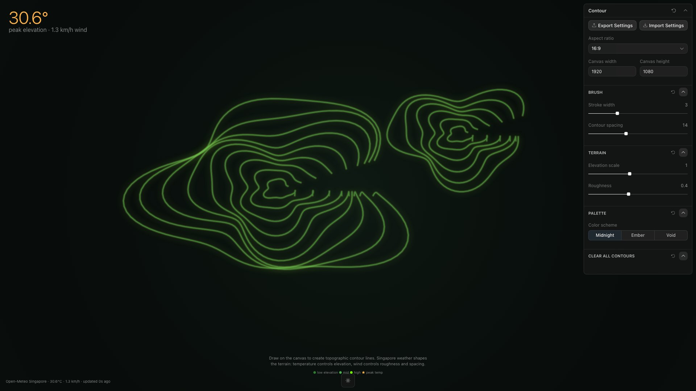

<div align="center">

<h1>contour</h1>

<p><b>Draw topographic contour lines, shaped by weather.</b></p>

<p><i>Every stroke you draw is lifted, tinted and roughened by the current temperature and wind in Singapore.</i></p>

<h6>


</h6>

<a href="#how-it-works"><b>How it works</b></a> ·
<a href="#controls"><b>Controls</b></a> ·
<a href="#run-it"><b>Run it</b></a>

<br><br>



<sub>Local build, 22 October 2026. Real Singapore weather at capture time; the strokes were drawn by a script.</sub>

</div>

<br>

contour is a small drawing instrument. You sketch freehand lines on a dark forest-green canvas
and they render as glowing topographic contours. What the lines look like is not up to you
alone: the page reads the current weather for Singapore (1.35° N, 103.82° E) from the free
[Open-Meteo](https://open-meteo.com) forecast API every 60 seconds, and every line on the
canvas reacts to it. A hot afternoon lifts and brightens the map; a windy one makes it ripple.

## How it works

| Weather (Open-Meteo `current_weather`) | Drives |
|---|---|
| `temperature` | How far every line is lifted: 20 to 35 °C maps to -40 to +40 px, times the Elevation scale slider |
| `temperature` | Line colour: deep green, mid green or neon green as the lift grows, with a soft glow above 15 px |
| `windspeed` | Wobble along each line: amplitude is roughness × wind speed × 0.15 |
| `windspeed` | Above 5 km/h, two faint echo lines are drawn below each stroke, one and two "contour spacings" apart |

The big gold number top-left is the live temperature, labelled as peak elevation. The stamp at
the bottom says `Open-Meteo Singapore` with the reading and how long ago it arrived; if the
request fails it switches to `(fallback)` and uses 28 °C and 10 km/h.

Tap close to a line (within 30 px) and a panel shows its point count, how long ago it was drawn
and the weather that is shaping it. It fades after three seconds. The canvas keeps the last 200
strokes.

## Controls

| Section | Control | Effect |
|---|---|---|
| Brush | Stroke width | 1 to 8 px |
| Brush | Contour spacing | Gap between the wind echo lines, 8 to 24 px |
| Terrain | Elevation scale | Multiplies the temperature lift, 0.3 to 2 |
| Terrain | Roughness | Multiplies the wind wobble, 0 to 1 |
| Terrain | Wind affects terrain | Turns the echo lines on or off |
| Palette | Color scheme | Midnight (green), Ember (orange) or Void (grey) |
| | Clear all contours | Wipes the canvas |

The control panel, canvas sizing and settings export come from Pixel Point's Toolcraft app
template, which this project was generated from.

## Run it

```bash
git clone https://github.com/parthchandak02/contour.git
cd contour
npm install
npm run dev      # Vite dev server on a free port
npm run build    # type-check, then a static site in dist/
```

The site was hosted on Cloudflare Pages at `contour.parthchandak.info`; that hostname no longer
resolves, so for now it runs locally only.

<details>
<summary><b>Project layout and licence</b></summary>

```
src/app/ContourCanvas.tsx  The piece: weather polling, drawing, rendering, overlays
src/app/app-schema.ts      Control panel definition (sliders, toggle, palette, clear)
src/routes/index.tsx       Mounts the canvas inside ToolcraftApp
src/toolcraft/             Toolcraft runtime and UI components (Pixel Point)
brief.md                   The original creative brief: concept, palette, encoding
e2e/                       Playwright browser tests from the template
```

Toolcraft code is covered by the Toolcraft Designer License in `LICENSE.md` (see `NOTICE.md`),
not an open-source licence.

</details>

<br>

<div align="center">
<sub>Built with React, Canvas 2D and Vite on the Toolcraft template. Weather from Open-Meteo.</sub>
</div>
