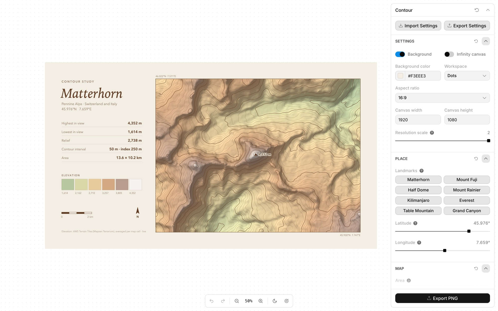

<div align="center">

<h1>Contour</h1>

<p><b>A topographic map of any mountain, from real elevation data.</b></p>

<p><i>Pick a landmark or any point on Earth, an area and a contour interval, and get a printable contour map with shaded relief.</i></p>

<h6>


</h6>

<a href="https://contour-topo.pages.dev"><b>Live app</b></a> ·
<a href="#how-it-works"><b>How it works</b></a> ·
<a href="#run-it"><b>Run it</b></a>

<br><br>

<a href="https://contour-topo.pages.dev"></a>

<sub>The default map: the Matterhorn, 50 m contours, tinted.</sub>

</div>

<br>

Contour draws a real contour map as a poster. The map shows contour lines with every fifth line
bolder as an index line, laid over a hypsometric tint (green valleys to pale summits) and a hillshade
lit from the north-west. The left column names the place and lists the highest and lowest ground in
view, the relief, the contour interval and the area covered, with an elevation legend, a scale bar
and a north arrow.

Pick one of eight landmarks (the Matterhorn, Mount Fuji, Half Dome, Mount Rainier, Kilimanjaro,
Everest, Table Mountain, the Grand Canyon), each with an area and interval that suit it, or drag
Latitude and Longitude anywhere between 80°S and 80°N. Choose the Area (Wide to Close), the
Contour interval (10 to 500 m) and a Style: Tinted, Relief (shading only) or Lines. The background
can be changed (dark colours flip the ink) or left out, and the map exports as PNG or JPG at 2K, 4K
or 8K.

## How it works

Elevation comes from [AWS Terrain Tiles](https://registry.opendata.aws/terrain-tiles/) (Mapzen's
Terrarium PNG tiles, free and keyless). Contour fetches the 6 to 9 tiles around the centre, decodes
each pixel's height, stitches a 512 × 384 grid, smooths it once and traces contour lines with
marching squares. Each map cell averages the ground under it (about 27 m at the Medium area), so
sharp summits read a little low: the Matterhorn shows 4,352 m against its surveyed 4,478 m. If the
tiles cannot be reached, a clearly labelled sample terrain is shown instead.

The map is drawn with Canvas 2D in a Web Worker at the exact zoomed backing resolution, and the same
drawing function renders the exported image. The editor shell, panel, settings import/export, saved
workspace and image export come from [Toolcraft](https://github.com/pixel-point/toolcraft) (Pixel
Point, MIT).

## Run it

```bash
git clone https://github.com/parthchandak02/contour.git
cd contour
npm install
npm run dev              # local editor; needs Node 22+
npm test                 # unit tests plus Toolcraft's contract checks
npm run verify:delivery  # full functional acceptance in a real browser
```

The live version is a static build (`npm run build`, then `dist/`) on Cloudflare Pages.

<details>
<summary><b>Project layout</b></summary>

```
src/contour/terrain.ts          Tile maths, Terrarium decoding, stitching, cache, offline sample
src/contour/contour-draw.ts     Contours, relief and the whole poster; preview and export share it
src/contour/ContourCanvas.tsx   The live canvas: worker raster at the exact backing size
src/contour/contour-controls.ts Place and Map controls; landmark shortcuts
src/app/app-schema.ts           Toolcraft schema: sections, canvas, image export
src/app/app-acceptance-data.ts  What every control must visibly do (checked in a real browser)
e2e/product-contour-*.spec.ts   Browser acceptance tests (tiles stubbed with generated PNGs)
src/toolcraft/                  Vendored Toolcraft runtime (do not edit)
```

</details>

<br>

<div align="center">
<sub>Built with Toolcraft, React and Canvas 2D. Elevation from AWS Terrain Tiles (Mapzen).</sub>
</div>
